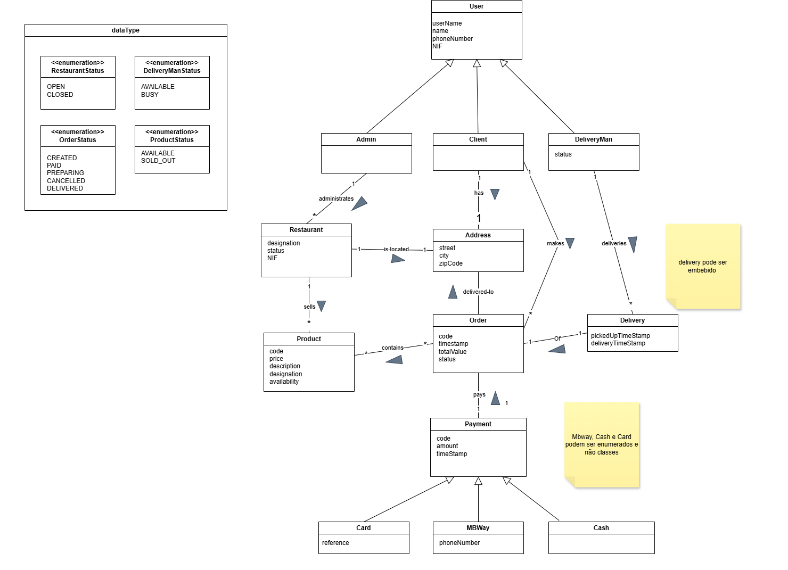

# TascaEats 🍽️

**TascaEats** is a food delivery platform developed as part of the **Software Systems Construction** course at Faculdade de Ciências da Universidade de Lisboa. The goal was to design and implement a backend system from scratch, applying concepts taught throughout the course — layered architecture, domain modelling, REST APIs, JPA, testing, and containerisation.

The platform connects customers, restaurant administrators, and delivery person through a REST API built with Spring Boot.

---

## Authors

| Name |
|------|
| Lana Santos |
| Bruno Antunes |
| Sofia Rodrigues |

---

## Context

Users can interact with the system under three distinct profiles — **Client**, **Restaurant Administrator**, and **Delivery Person** — sharing base authentication data but with different roles and permissions.

Core features include:
- User registration, authentication (mocked), and management
- Restaurant and menu management
- Order creation and lifecycle management with associated payment
- Delivery logistics — assigning available delivery persons to ready orders
- Order cancellation with business rule enforcement

---

## Domain Model 


## Running the Project

The project has been tested and runs correctly on **Windows** and **Ubuntu**, provided **Docker is installed.**
 
> **macOS users:** Running the project on Mac would require a `docker-compose.override.yml` with platform-specific adjustments. Although one team member used such a file during development, we decided not to include it in the repository. The project is therefore intended to be run on Windows or Ubuntu only.

From the project root, run:

```bash
bash run.sh
```

This starts the application and the PostgreSQL database in a Docker environment. The API is available at `http://localhost:8080` and the Swagger UI at `http://localhost:8080/swagger-ui/index.html`.

---

## Database

The application uses **PostgreSQL**. You can connect via [DBeaver](https://dbeaver.io/) with the following credentials:

| Field    | Value       |
|----------|-------------|
| Host     | `localhost` |
| Port     | `5432`      |
| Database | `postgres`  |
| User     | `user`      |
| Password | `password`  |

> **Note:** By default, the database is recreated on each run. To persist data between executions, change `spring.jpa.hibernate.ddl-auto` in `src/main/resources/application.properties` from `create-drop` to `update`.

---

## Sample Data

For convenience, the database is automatically populated on startup via `BdLoader.java`, located in `src/main/java/.../config`. This seeds the database with sample data to make it easier to test the endpoints right away.

---

## Tests & Coverage

The project includes unit tests achieving **84% code coverage**, validating business logic and exception scenarios across the Service and Controller layers.

A coverage report is automatically generated during the build using **JaCoCo**. To access it, with the project running in the background:

```bash
docker compose cp springbootapp:/app/jacoco-report ./jacoco-report
```

Then open `./jacoco-report/index.html` in your browser.

---

## Implementation Notes

### User Deletion

User deletion follows a **hard delete / soft delete** strategy depending on the user's state:

- **Admin:** permanently deleted only if no restaurants are associated
- **Customer:** hard deleted if no orders exist; soft deleted if all orders are completed (or cancelled); blocked if any order is still in progress
- **Delivery Person:** same logic, based on associated deliveries

The controller currently returns `404` both when a user is not found and when deletion is blocked by a business rule. This ambiguity was a conscious decision — in a future phase, this distinction could be handled at another layer (e.g. authentication/authorisation) by simply not exposing the endpoint in cases where deletion is not permitted, making the differentiation unnecessary at the controller level.

---

## Demonstration Video 

> https://drive.google.com/drive/folders/1WTw22PetVufq2TXbswLgPwXUsL_1rdIK?usp=drive_link