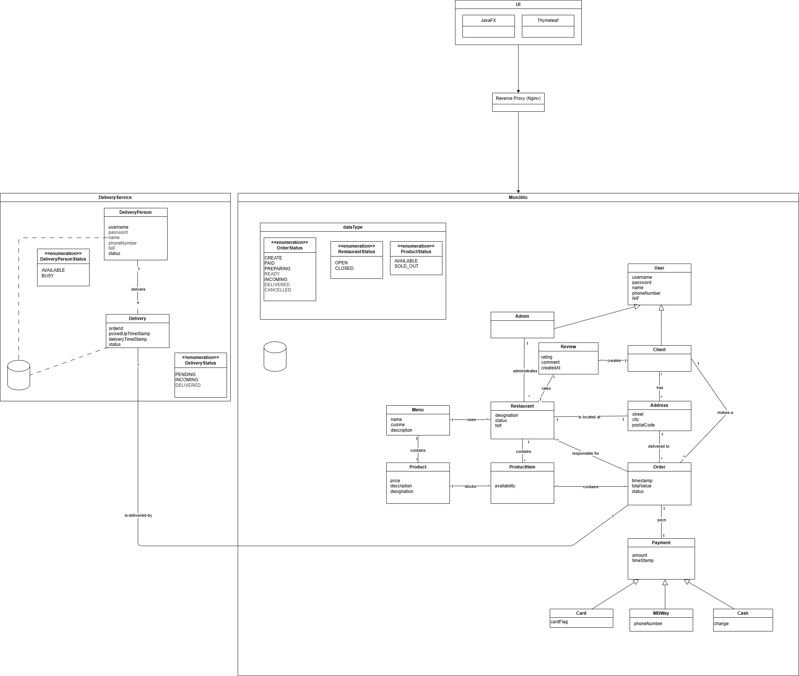

# TascaEats 🍽️

**TascaEats** is a food delivery platform developed as part of the **Software Systems Construction** course at Faculdade de Ciências da Universidade de Lisboa. The goal was to design and implement a backend system from scratch, applying concepts taught throughout the course — layered architecture, domain modelling, REST APIs, JPA, testing, and containerisation.

The platform connects customers, restaurant administrators, and delivery persons through a REST API built with Spring Boot, a web interface built with Thymeleaf, and a desktop application built with JavaFX communicating via gRPC.

---

## Authors

| Name |
|------|
| Lana Santos |
| Bruno Antunes |
| Sofia Rodrigues |

---

## Context

Users can interact with the system under three distinct profiles — **Client**, **Restaurant Administrator**, and **Delivery Person** — sharing base authentication data but with different roles and permissions.

Core features include:
- User registration, authentication (mocked), and management
- Restaurant and menu management
- Order creation and lifecycle management with associated payment
- Delivery logistics — assigning available delivery persons to ready orders
- Order cancellation with business rule enforcement

---

## Demonstration Video

> https://drive.google.com/drive/folders/1WTw22PetVufq2TXbswLgPwXUsL_1rdIK?usp=drive_link

> **Note:** The video does not cover every implemented feature exhaustively, but walks through the main user flows across the three interfaces.

## Domain Model


## Phase 2 — Changes and Extensions

### Backend / Core

The following domain-level changes were introduced in the second phase:

- **Multiple addresses per client:** a client can now have more than one delivery address and may register a new address when placing an order.
- **Multi-restaurant orders:** an order can include products from more than one restaurant.
- **Product availability scoped to restaurants:** products belong to menus, and menus can be shared across multiple restaurants. However, a product's availability is managed independently within each restaurant's scope.
- **Restaurant reviews:** a client can review a restaurant only after having placed an order there. Submitting a review without a prior order is not permitted.
- **Automatic delivery assignment:** the system automatically assigns an available delivery person to an order once it reaches the `READY` state.
- **Enriched payment records:** payment information now includes method-specific details beyond the payment method itself — MBWay stores a phone number, card stores the card brand/flag, and cash stores the change amount returned.

---

### Interfaces

Three interfaces expose the backend's functionality:

#### 1. REST / Swagger

The existing REST endpoints (accessible via Swagger UI) were updated and extended to reflect the new features introduced in this phase.

#### 2. Web Interface (Thymeleaf)

A web interface was implemented using Thymeleaf, communicating with the backend through dedicated web controllers.

This interface was designed for **client** users and supports:
- Account creation and profile editing
- Browsing restaurants and orders
- Placing and cancelling orders
- Reviewing a restaurant after placing an order there

If a user with a different role (admin, delivery person) logs in, the interface displays a message indicating that the platform is not designed for their profile and directing them to the appropriate access point.

#### 3. Desktop Application (JavaFX + gRPC)

A native desktop application was built using **JavaFX**, communicating with the backend via **gRPC**. This interface serves as an alternative to Swagger and the web interface, and was designed for three distinct personas:

**Admin:**
- Register, authenticate, and update their profile
- Manage their restaurants: edit status, assign menus, and control product availability within the scope of a given restaurant
- Create new restaurants

**Delivery Person:**
- Register, authenticate, and update their profile
- Order listing for delivery persons is not implemented in this phase and is deferred to a future iteration

**BackOffice (system manager):**
Accessible from the first login screen of the JavaFX app via a dedicated "BackOffice" tab. This persona does not correspond to a concrete domain user — it represents the system's self-management layer, intended for a platform operator or superadmin. It is currently accessible without authentication.

Through the BackOffice, the operator can:
- Access the custom search/filter views introduced in this phase (filters for users, products, menus, and restaurants)
- **Menu management (Use case G):** create and edit products — since menus can be shared across restaurants, this was not attributed to any specific admin
- **Order management (Use cases K, L, and N):** since orders may span multiple restaurants, order lifecycle management was also kept at this system-wide level rather than assigned to a specific restaurant admin

If a **client** attempts to authenticate via this application, a message is displayed informing them that they cannot act as a client here and should use the web platform instead.

---

## Project Structure

The project is now split into two independent sub-projects:

| Sub-project | Description | How to run |
|---|---|---|
| `TascaEats` | Backend + REST (Swagger) and web (Thymeleaf) controllers | `bash run.sh` (requires Docker) |
| `JavaFX` | Native desktop application (JavaFX + gRPC) | `cd JavaFX && mvn javafx:run` |

### Running TascaEats (Backend + Web)

The backend has been tested and runs correctly on **Windows** and **Ubuntu**, provided **Docker is installed.**

> **macOS users:** Running the project on Mac would require a `docker-compose.override.yml` with platform-specific adjustments. Although one team member used such a file during development, we decided not to include it in the repository. The project is therefore intended to be run on Windows or Ubuntu only.

From the project root, run:

```bash
bash run.sh
```

This starts the application and the PostgreSQL database in a Docker environment. The API is available at `http://localhost:8080`, the Swagger UI at `http://localhost:8080/swagger-ui/index.html`, and the web interface at `http://localhost:8080`.

### Running the JavaFX Application

**Requirements:**
- Java 21+ (**headful** JDK — the headless variant does not support graphical interfaces)
- Maven
- Ensure the `JAVA_HOME` environment variable points to the headful JDK installation

```bash
cd JavaFX
mvn javafx:run
```

---

## Database

The application uses **PostgreSQL**. You can connect via [DBeaver](https://dbeaver.io/) with the following credentials:

| Field    | Value       |
|----------|-------------|
| Host     | `localhost` |
| Port     | `5432`      |
| Database | `postgres`  |
| User     | `user`      |
| Password | `password`  |

> **Note:** By default, the database is recreated on each run. To persist data between executions, change `spring.jpa.hibernate.ddl-auto` in `src/main/resources/application.properties` from `create-drop` to `update`.

---

## Sample Data

For convenience, the database is automatically populated on startup via `BdLoader.java`, located in `src/main/java/.../config`. This seeds the database with sample data to make it easier to test the endpoints right away.

---

## Tests & Coverage

Given the scope of the project, the team focused test coverage on the core of the application — the **service layer**, where all business rules are enforced. Coverage above **80%** was achieved for these classes and was demonstrated via the JaCoCo report.

A coverage report is automatically generated during the build. To access it, with the project running in the background:

```bash
docker compose cp springbootapp:/app/jacoco-report ./jacoco-report
```

Then open `./jacoco-report/index.html` in your browser.

---

## Code Quality

Code quality in this phase was enforced using **pre-commit hooks**, ensuring that checks run automatically before each commit.

---

## Implementation Notes

### gRPC Protocol (`tascaeats.proto`)

| RPC | Request | Response | Description |
|---|---|---|---|
| `Login` | `LoginRequest` | `UserResponse` | Authenticate a user and return their profile |
| `RegisterAdmin` | `UserRequest` | `UserResponse` | Register a new admin account |
| `RegisterDeliveryPerson` | `UserRequest` | `DeliveryPersonResponse` | Register a new delivery person account |
| `DeleteAccount` | `DeleteAccountRequest` | `Empty` | Delete a user account by ID |
| `UpdateAdmin` | `UserRequest` | `UserResponse` | Update an admin's profile data |
| `UpdateClient` | `UserRequest` | `UserResponse` | Update a client's profile data |
| `UpdateDeliveryPerson` | `DeliveryPersonUpdateRequest` | `DeliveryPersonResponse` | Update a delivery person's profile and status |
| `SearchUsers` | `SearchUsersRequest` | `SearchUsersResponse` | Search users with optional filters (name, type, order count, delivery count) |
| `SearchRestaurants` | `SearchRestaurantsRequest` | `RestaurantsResponse` | Search restaurants with optional filters |
| `SearchAdminRestaurants` | `AdminRestaurantsRequest` | `AdminRestaurantsResponse` | Search restaurants owned by a given admin with optional filters |
| `SearchMenus` | `SearchMenusRequest` | `MenusSearchResponse` | Search menus with optional filters (name, product count, average price) |
| `SearchProducts` | `SearchProductsRequest` | `ProductsSearchResponse` | Search products with optional filters (designation, price, description, availability, times ordered) |
| `GetAllMenus` | `Empty` | `MenusResponse` | Retrieve all available menus |
| `AssignMenu` | `AssignMenuRequest` | `Empty` | Assign a menu to a restaurant |
| `ChangeRestaurantStatus` | `ChangeStatusRequest` | `Empty` | Change the status of a restaurant (OPEN / CLOSED) |
| `CreateRestaurant` | `CreateRestaurantRequest` | `RestaurantItem` | Create a new restaurant for a given admin |
| `GetRestaurantProducts` | `GetRestaurantProductsRequest` | `ProductsResponse` | Search products of a restaurant with optional filters |
| `UpdateProductStatus` | `UpdateProductStatusRequest` | `Empty` | Update the availability status of a product within a restaurant |
| `GetAllOrders` | `Empty` | `OrdersResponse` | Retrieve all orders in the system |
| `SearchOrders` | `SearchOrdersRequest` | `OrdersResponse` | Search orders filtered by status |
| `ProcessPayment` | `PaymentRequest` | `OrderResponse` | Process payment for an order |
| `UpdateOrderStatus` | `UpdateOrderStatusRequest` | `OrderResponse` | Update the status of an order |
| `CancelOrder` | `OrderIdRequest` | `Empty` | Cancel an order by ID |
| `GetMenuProducts` | `MenuIdRequest` | `MenuProductsResponse` | Retrieve all products belonging to a menu |
| `AddProduct` | `AddProductRequest` | `ProductResponse` | Add a new product to a menu |
| `UpdateProduct` | `UpdateProductRequest` | `ProductResponse` | Update an existing product in a menu |
| `DeleteProduct` | `DeleteProductRequest` | `Empty` | Delete a product from a menu |
| `CreateMenu` | `CreateMenuRequest` | `MenuItemMessage` | Create a new menu |
| `UpdateMenu` | `UpdateMenuRequest` | `MenuItemMessage` | Update an existing menu |
| `DeleteMenu` | `DeleteMenuRequest` | `Empty` | Delete a menu by ID |

---
